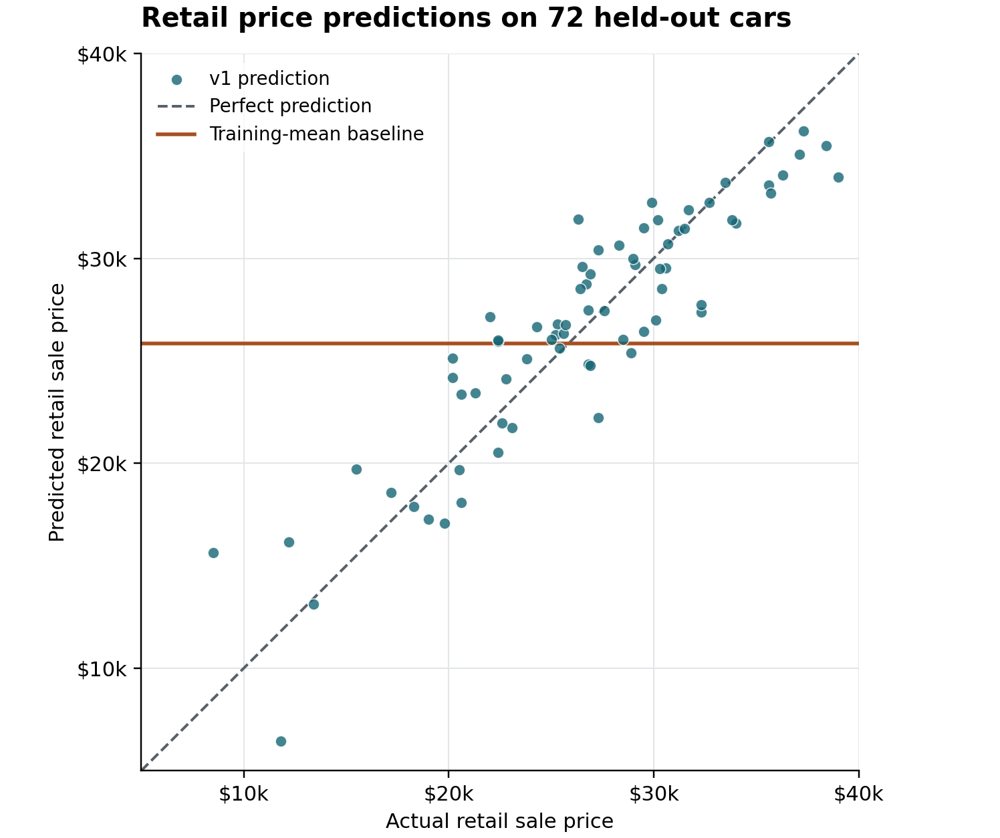

# Used-car pricing and auction results

## Data and split

The course dataset contains 240 retail sales from the dealer's last year. A random 70/30 split with seed 42 assigns 168 cars to training and 72 to testing. The separate auction dataset contains 40 lots from one recent auction. Its later retail prices come from a market data service.

## Training fit

Both models use ordinary least squares with an intercept and retail sale price in dollars as the outcome. Accident is 1 for yes and 0 for no. Each coefficient holds the other included features fixed. P-values use two-sided OLS t tests.

| Term | Full estimate | Full p-value | v1 estimate | v1 p-value | Meaning |
|---|---:|---:|---:|---:|---|
| Intercept | $21,698.63 | 3.13e-45 | $21,762.40 | 7.35e-49 | Reference prediction with all numeric inputs zero and no accident |
| Mileage_K | -$78.59 | 6.63e-08 | -$78.15 | 4.32e-08 | Change for an additional 1,000 miles |
| Age_Years | -$1,300.64 | 5.54e-11 | -$1,291.63 | 1.16e-11 | Change for one additional year of age |
| Horsepower | $75.02 | 1.24e-34 | $75.02 | 7.79e-35 | Change for one additional horsepower |
| Accident | -$2,171.78 | 3.67e-05 | -$2,176.64 | 3.25e-05 | Difference for an accident on record compared with none |
| Num_Owners | $62.92 | 0.865 | — | — | Change for one additional previous owner |

Training adjusted R² is 0.86905 with all five inputs and 0.86983 after removing Num_Owners. The owner-count estimate is $62.92 per additional owner (p = 0.865). The four-feature model is v1. It uses one fewer input and has slightly higher adjusted R². Each retained slope has p < 0.001. The intercept is an extrapolation because a car with zero horsepower is outside the observed range.

## Held-out test fit

The baseline predicts the training mean of $25,851.19 for every car. Test R² uses the mean of the test outcomes as the reference for scoring both predictions. The training and test means differ, so the baseline can score slightly below zero.

| Price estimate | Test R² | Test RMSE |
|---|---:|---:|
| baseline | -0.01368 | $6,494.15 |
| v1 | 0.82268 | $2,716.14 |

The diagonal represents an exact prediction. Points above it indicate overestimates. The horizontal line is the baseline prediction for every car.

## Auction backtest

Buy when predicted retail price exceeds the auction price plus $1,500 in preparation costs. Pass at equality. For a purchase, realized profit equals later retail price minus the auction price and preparation cost. A pass earns zero. A purchase counts as a loss only when its realized profit is negative.

| Buying rule | Cars bought | Loss-making purchases | Total realized profit |
|---|---:|---:|---:|
| baseline | 14 | 10 | -$6,000 |
| v1 | 17 | 6 | $15,800 |

Incremental profit over the baseline for these 40 lots: $21,800.
